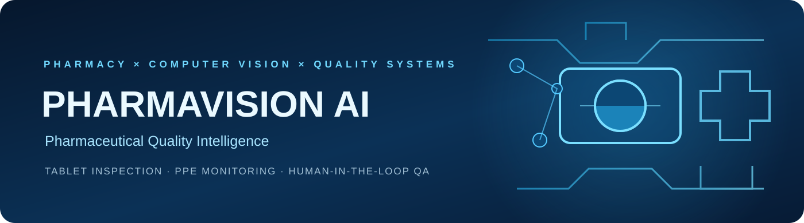

<p align="center"></p>
<p align="center">
  <a href="https://github.com/khnbutt118-dev"></a>
  
  
</p>
<p align="center"><a href="https://github.com/khnbutt118-dev">Profile</a> · <a href="https://hassanbuttportfolio.vercel.app/">Portfolio</a> · <a href="https://www.linkedin.com/in/hassan-butt-ab0036334/">LinkedIn</a></p>

# PharmaSight AI
### A modular computer-vision foundation for pharmaceutical quality workflows

> **Research and decision-support prototype.** This repository is a phased starter scaffold; it is not a GMP-validated inspection system and does not make batch-release decisions.

<table>
<tr>
<td align="center" width="25%"><h2>💊</h2><b>Tablet QA</b><br><sub>Appearance inspection foundation</sub></td>
<td align="center" width="25%"><h2>📦</h2><b>Blister checks</b><br><sub>Completeness roadmap</sub></td>
<td align="center" width="25%"><h2>🥼</h2><b>PPE monitoring</b><br><sub>Visible compliance signals</sub></td>
<td align="center" width="25%"><h2>🖐️</h2><b>Interaction</b><br><sub>Gesture and voice roadmap</sub></td>
</tr>
</table>

## 🧭 Project map

| Module | Purpose | Current position |
|:--|:--|:--|
| Tablet appearance | Foundation for tablet-defect inspection | Phase 1 data audit / modelling target |
| Blister completeness | Explore missing or damaged units | Planned phase |
| PPE monitoring | Monitor visible PPE indicators | Planned module |
| Gesture interface | Hands-free interaction | Planned module |
| Voice alerts & QA records | Spoken alerts and inspection records | Planned module |

## ⚡ Get started

<details open>
<summary><b>1 · Set up on Windows</b></summary>

```powershell
py -m venv .venv
.\.venv\Scripts\Activate.ps1
python -m pip install --upgrade pip
pip install -r requirements.txt
```
Optional packages for later phases (gestures, voice, YOLO) are listed in `requirements-optional.txt`. Install them only when needed.
</details>

<details>
<summary><b>2 · Run the first checks</b></summary>

```powershell
python -c "import torch, cv2; print('PyTorch:', torch.__version__); print('CUDA:', torch.cuda.is_available()); print('OpenCV:', cv2.__version__)"
python webcam_test.py
python -m pytest
```
Launch the placeholder dashboard with `streamlit run app.py`.
</details>

<details>
<summary><b>3 · Organise the datasets</b></summary>

```text
datasets/
├── raw/
│   ├── tablet_defects/
│   ├── blister_packs/
│   └── ppe/
├── processed/
└── dataset_manifest.csv
```
Keep original downloads unchanged in `raw`, with each dataset in its own source folder. Check licensing, labels and annotation compatibility before combining sources.
</details>

## 🔬 Phase 1 · Data quality toolkit

| Command | What it checks |
|:--|:--|
| `validate_images` | Image validity and readability |
| `build_manifest` | Creates a dataset inventory |
| `find_duplicates` | Flags exact / near-duplicate candidates |
| `suggest_labels` | Creates label suggestions for manual review |

```powershell
python -m src.data.validate_images --root datasets/raw/tablet_defects --recursive
python -m src.data.build_manifest --root datasets/raw/tablet_defects --output datasets/dataset_manifest.csv --task tablet
python -m src.data.find_duplicates --root datasets/raw/tablet_defects
python -m src.data.suggest_labels
```

<blockquote>Manifest labels are intentionally left empty. Suggested labels are not ground truth; manually verify them against each dataset's documentation. Review duplicate candidates visually before removing or changing data.</blockquote>

## 🛡️ Validation principles

<table>
<tr><td>🧪 <b>Leakage control</b></td><td>Prefer source-, batch-, sample- or capture-session-separated splits; hold out a source/session for external testing.</td></tr>
<tr><td>📉 <b>Safety-sensitive metrics</b></td><td>Report defective-sample recall, false-pass rate, precision, specificity, per-class F1, confusion matrix and latency.</td></tr>
<tr><td>👩‍🔬 <b>Human review</b></td><td>Low confidence should lead to an uncertain/manual-review state, never an automatic pass.</td></tr>
<tr><td>🏭 <b>Scope boundary</b></td><td>Predictions do not establish manufacturing root cause and cannot replace qualified inspection, AQL sampling, SOPs or batch release.</td></tr>
</table>

## 📍 Current project status

<p>


</p>

See `docs/` for the data protocol, validation plan, project scope and phased roadmap.

---
<p align="center"><sub>Built at the intersection of pharmaceutical science, computer vision and responsible AI.</sub></p>